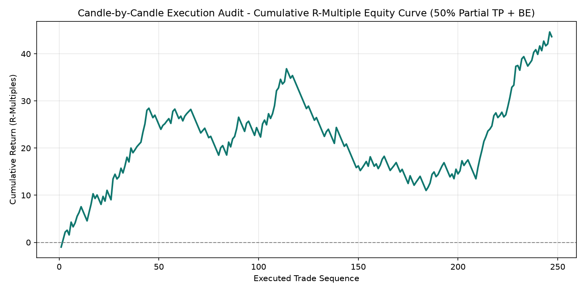
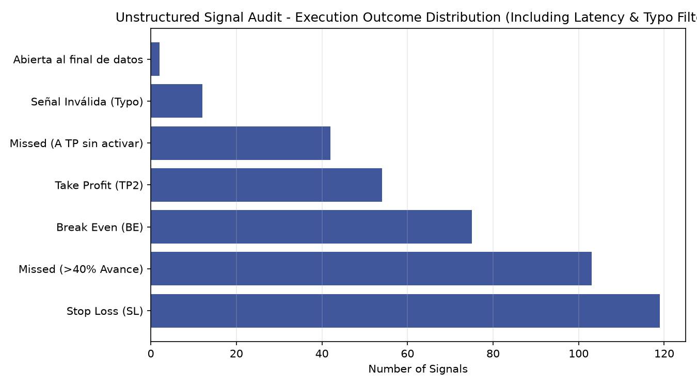

# Intraday Signal Execution Auditor & Latency Backtesting Engine

Candle-by-candle (`M1`) execution simulation, regex-based unstructured signal parsing, typo/anomaly filtering, and execution latency modeling across multi-asset FX and commodity markets (`XAUUSD`, `EURUSD`, `GBPUSD`, `AUDUSD`, `NZDUSD`, `USDJPY`).

---

## Overview

Evaluating external or discretionary trading signals requires accounting for real-world execution constraints that standard idealized backtests ignore: **human/API execution latency**, **price front-running prior to order placement**, **structural typos in order parameters**, and **multi-stage partial profit-taking**.

This repository implements an auditing engine in Python (`src/signal_execution_auditor.py`) that:
1. **Parses Unstructured Text Logs via Regular Expressions**: Extracts timestamped trade directives (`Asset`, `BUY/SELL`, `Entry`, `SL`, `TP1`, `TP2`) and normalizes broker server timestamps (`Europe/Athens`) to local execution time (`America/Bogota` / `EST`).
2. **Enforces Pre-Trade Sanity & Typo Filters**: Automatically flags and rejects malformed signals where Stop-Loss or Take-Profit levels violate directional monotonicity ($SL < \text{Entry} < TP$ for long positions, and vice versa) or contain decimal-point entry errors.
3. **Simulates Execution Latency (`+2 Minutes`) & Front-Running Rules**: Applies a mandatory 2-minute execution delay after signal broadcast. If price advances $>40\%$ toward `TP1` or triggers `TP1` before order activation, the trade is classified as `Missed` rather than curve-fitted as a win.
4. **Models Partial Position Scaling (`50% TP1 + Break-Even`)**: Simulates closing $50\%$ of position size at `TP1` while migrating the remaining $50\%$ Stop-Loss to entry (`Break-Even`), measuring exact realized $R$-multiples.

---

## Empirical Audit Results

Across 405 parsed signal events (`results/session_performance_summary.csv`), 145 signals were invalidated by the 2-minute latency / 40% front-running rule and 13 were rejected by the pre-trade typo filter, leaving 247 valid executed trades:

| Session Window | Executed Trades | Missed (Latency) | Filtered Typos | Win Rate (`TP2 + BE`) | Avg RR (`TP2`) | Avg RR (`Partial BE`) | Net Return (`R`) | Max Drawdown (`R`) |
| :--- | :---: | :---: | :---: | :---: | :---: | :---: | :---: | :---: |
| **NY Morning (`07:00-11:00 EST`)** | `88` | `59` | `4` | `48.86%` | `1 : 2.30` | `1 : 0.67` | `+11.65 R` | `-10.31 R` |
| **Off-Peak Sessions** | `159` | `86` | `9` | `53.46%` | `1 : 2.01` | `1 : 0.56` | `+31.98 R` | `-18.89 R` |
| **Global (`24h All Sessions`)** | `247` | `145` | `13` | `51.82%` | `1 : 2.11` | `1 : 0.60` | `+43.63 R` | `-25.82 R` |

---

## Visual Audit Results

| Cumulative Realized R-Multiple Equity Curve | Signal Execution Outcome Distribution |
| :---: | :---: |
|  |  |

---

## Repository Structure

```text
intraday-signal-execution-auditor/
├── plots/
│   ├── cumulative_r_equity.png               # Realized R-multiple equity progression
│   └── execution_outcome_distribution.png    # Breakdown of executed, missed, and invalid signals
├── results/
│   ├── execution_audit_report.csv            # Trade-by-trade execution log with realized R
│   └── session_performance_summary.csv       # Aggregated metrics by trading session (NY vs. Off-Peak)
├── src/
│   └── signal_execution_auditor.py           # Regex parser, latency simulator, and performance auditor
├── .gitignore
├── requirements.txt
└── README.md
```

---

## Usage & Reproduction

```bash
# 1. Install dependencies
pip install -r requirements.txt

# 2. Run the execution audit summary and generate session performance tables
python src/signal_execution_auditor.py
```

---

## Author

**Andrés Felipe Maestre Badillo**  
B.S. Candidate in Energy and Sustainability Engineering — Minor in Data Science  
Universidad Autónoma de Bucaramanga (UNAB)  
Email: afmae556@gmail.com
